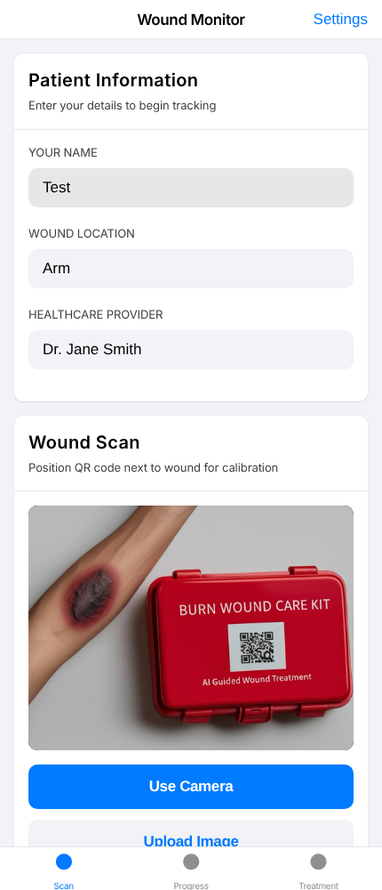
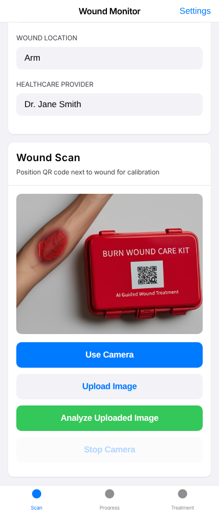

# Wound Monitor

A browser app that measures a wound from a photo and tracks healing over time. A QR code of known size (2.5 cm) placed next to the wound gives the pixel-to-centimetre scale. A YOLO segmentation model (QATbest.onnx, run with onnxruntime-web) finds the wound area.

All data is dummy data. This app is not medical advice.

Status: capstone prototype, under construction.

## Backend

None. The app is static and offline-first. Scans are kept in browser localStorage (last 50). No Firebase or other hosted backend is called from the code. No credentials and no `.env.example` are needed. The Firestore and Storage rules in this repo deny all access.

## Run it

No install step and no lockfile. All browser libraries are in `vendor/`. Nothing is fetched from a CDN.

    python3 -m http.server 8000

Open http://localhost:8000. Camera use needs localhost or https. Upload works anywhere.

Limits:

- First load downloads the 13 MB model and an 11 MB wasm file. Both are cached after that.
- Inference runs on one CPU thread.
- The QR code must decode for centimetre values. Otherwise the numbers are in pixels.
- The model finds one kind of object. It can miss a wound (Demo_2.jpg gives an empty mask).

Why not the tflite file: tfjs-tflite 0.0.1-alpha.10 looks for its wasm in the wrong folder. With the path fixed, `QATbest_int8.tflite` still fails: `transpose_conv.cc:299 weights->type != input->type (INT8 != FLOAT32)`, then `Can't initialize model`. So the app uses the ONNX file. The tflite file stays in the folder, unused.

Model output: `output0` [1,37,2100] (box, score, 32 mask coefficients) and `output1` [1,32,80,80] (mask prototypes). Input `images` [1,3,320,320], RGB, 0 to 1. The app keeps boxes above score 0.25, applies NMS at 0.45, builds each mask from the prototypes, and joins them.

Checked, headless Chromium against the local server:

- Model loads, no console error, no request outside localhost.
- Demo_0.jpg: mask 17313 px. Demo_1.jpg: mask 7906 px. Overlay drawn, area and perimeter shown (in pixels, the demo QR does not decode).
- Same images through Python onnxruntime with the same steps: IoU 0.980 on both.

To repeat: start the server on port 8123, then run `tests/e2e.js` (Playwright) and `tests/iou.py`. Not a comparison against ground truth. The IoU only says the browser matches Python.

Tests: no unit tests exist. The two scripts in `tests/` are the end to end check.

## Screenshots

Before analyze: photo loaded, no mask.

After analyze: mask over the wound, measurement recorded.

## Files

- `index.html`: page and styles.
- `ios-camera.js`: camera, QR calibration, segmentation, local storage.
- `QATbest.onnx`: model loaded by the app. `QATbest_int8.tflite` does not run in the browser (see above). `QATbest.pt` is the source.
- `vendor/`: local libraries, see `vendor/README`.
- `tests/`: browser check and Python reference.
- `Wound kit Final images/`: demo images, dummy data.
- `firestore.rules`, `storage.rules`: deny all.
- `vercel.json`: static hosting headers.
